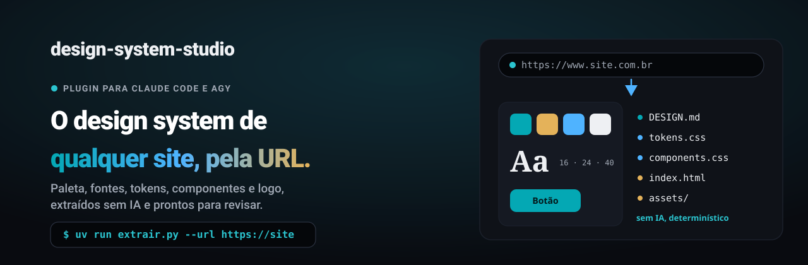

<p align="center">
  
</p>

<p align="center">
  
  
  
  
  
</p>

<h3 align="center">Passe a URL e receba o design system do site.<br>Paleta, fontes, tokens, componentes e logo, extraídos sem IA e prontos para revisar.</h3>

---

## O que é

O **design-system-studio** é um plugin com a skill `extrair-design-system`. Você passa a URL de um site e o script `extrair.py` monta a estrutura padrão de um design system:

| Arquivo | O que tem |
|---|---|
| `DESIGN.md` | Fonte e data, decisões (cada papel de cor e de fonte com o porquê), paleta, tipografia, espaçamento, componentes, marca e como usar |
| `tokens.css` | As custom properties do `:root` do site, como estão, e os tokens propostos (`--ds-cor-primaria`, `--ds-fonte-texto`, `--ds-raio-1`...) |
| `components.css` | As regras de botões, links, cartões, campos, cabeçalho e rodapé, copiadas do CSS do site |
| `index.html` | Vitrine que abre direto no navegador, sem servidor e sem nenhum script |
| `assets/` | Logo, favicon e ícones baixados do site |

A extração é **determinística**: a mesma URL gera a mesma saída, e cada escolha vem de uma regra escrita no `DESIGN.md`. Depois, a IA revisa: confere a vitrine, ajusta o que a página real contradisser e escreve o tom da marca.

## Por que usar

| | |
|---|---|
| **Sem IA na extração** | Cores contadas e classificadas por regra explicável. Nada de paleta diferente a cada pedido |
| **Entende sites com tokens** | Resolve `var(--x)` antes de contar, segue os `@import` e lê `@font-face` e Google Fonts |
| **Seguro por padrão** | Só `http` e `https` públicos, endereço conferido em cada pedido e redirecionamento, limite de bytes e de tempo, e o JavaScript do site nunca roda |
| **Pronto para revisar** | Vitrine com as classes do próprio site e um roteiro curto para a IA completar o `DESIGN.md` |
| **Respeita a marca** | O uso é de referência: a skill orienta a não publicar logo, fontes e imagens de terceiros |
| **Só stdlib** | Python 3.11+ com `uv`, nenhum pacote de terceiros; captura opcional com o Chrome pelo protocolo DevTools |

## Antes de começar

Roda no **macOS**, no **Linux** e no **Windows**, com **Claude Code** ou **agy**. Não precisa de conta nem de chave.

| | O que precisa | Detalhe |
|---|---|---|
| **Programas** | [`uv`](https://docs.astral.sh/uv/) e Python 3.11+ | O `uv` instala o Python. Nada de `pip` |
| **Opcional** | Google Chrome ou Chromium | Só para `--captura` (variável `CHROME_BIN` se estiver fora do lugar padrão) |
| **Rede** | Acesso ao site que vai ser lido | Endereços locais e privados são recusados |
| **Licença** | MIT | |

## Instalação

### No Claude Code

```
/plugin marketplace add nathanramorim/design-system-studio
/plugin install design-system-studio@design-system-studio
```

Ou pelo terminal:

```bash
claude plugin marketplace add nathanramorim/design-system-studio
claude plugin install design-system-studio@design-system-studio --scope user
```

### No agy (Antigravity), ou como skill pessoal

```bash
gh repo clone nathanramorim/design-system-studio
mkdir -p .agents/skills
cp -R design-system-studio/plugins/design-system-studio/skills/extrair-design-system .agents/skills/
```

No Windows (PowerShell):

```powershell
gh repo clone nathanramorim/design-system-studio
New-Item -ItemType Directory -Force .agents\skills | Out-Null
Copy-Item -Recurse design-system-studio\plugins\design-system-studio\skills\extrair-design-system .agents\skills\
```

## Como usar

Peça normalmente: **"extraia o design system de https://www.site.com.br"**. A skill entra sozinha. Ou use o comando:

```
/extrair-design-system https://www.site.com.br design-systems/site
```

Direto no terminal:

```bash
uv run plugins/design-system-studio/skills/extrair-design-system/scripts/extrair.py \
  --url https://www.site.com.br --saida design-systems/site --nome "Marca" --captura
```

Para experimentar sem rede, sirva o site fictício do repositório e extraia dele:

```bash
python3 -m http.server 8000 --bind 127.0.0.1 --directory plugins/design-system-studio/skills/extrair-design-system/exemplos/site-exemplo
uv run plugins/design-system-studio/skills/extrair-design-system/scripts/extrair.py --url http://127.0.0.1:8000/ --saida /tmp/oficina --permitir-local
```

Saída real:

```
OK | pagina | HTTP 200, 2613 bytes, http://127.0.0.1:8000/
OK | css | 2 folhas (1 por @import), 30 regras
OK | cores | 9 cores; fundo #FBF8F3, texto #1E1B16, primária #1F6F5C, destaque #E07A2F
OK | fontes | Inter (texto), Fraunces (títulos), Oficina Mono (código); 7 tamanhos
OK | medidas | 3 raios, 1 sombra, 9 espaços
OK | componentes | botões 6, links 3, cartões 3, campos 2, cabeçalho 1, rodapé 1
OK | marca | og:image og-imagem.png, favicon favicon.svg, ícone icone-1.png, logo logo.svg
RESULTADO: estrutura gerada em /tmp/oficina (0 avisos)
```

| Opção | Para quê |
|---|---|
| `--nome` | Nome da marca (padrão: `og:site_name`, título ou domínio) |
| `--captura` | Captura de tela com o Chrome headless, com o JavaScript desligado |
| `--sobrescrever` | Regrava uma pasta que já tem `DESIGN.md` |
| `--limite-bytes`, `--tempo` | Limite por arquivo (2 MB) e por pedido (15 s) |
| `--data` | Data fixa no `DESIGN.md`, para comparar extrações |
| `--json` | Resumo em JSON para outro agente |
| `--permitir-local` | Aceita só o loopback, para testes e servidor de desenvolvimento |

Códigos de saída: **0** estrutura gerada, **1** a página não veio (rede, limite de bytes ou de tempo), **2** uso inválido ou endereço recusado.

## Segurança e privacidade

- Só lê: nenhum formulário é enviado e nenhum JavaScript do site é executado.
- Recusa loopback, redes privadas, link-local (inclusive metadados de nuvem), endereços reservados e redirecionamentos para eles. A conexão vai para o IP conferido.
- User-Agent próprio e identificável: `design-system-studio/0.1.0 (+https://github.com/nathanramorim/design-system-studio)`. Se o site recusar, o erro aparece como está.
- SVG baixado passa por limpeza (sem `script`, `foreignObject` e eventos `on*`) e a vitrine mostra imagens só por ``.

## Limites honestos

- **CSS montado por JavaScript não aparece.** Sites que só estilizam por script (CSS-in-JS) saem incompletos; a captura mostra o visual real.
- **Os papéis são heurísticos.** As regras são fixas e explicadas, mas um site atípico pede a revisão que a skill descreve.
- **Folhas do Google Fonts não são baixadas.** A família sai do link; a licença de fontes próprias fica com quem for usar.
- **Cores em `oklch`, `lab` e `color-mix` não entram na contagem.** Tamanhos em `rem` e `em` consideram 16px.

## Desenvolvimento

```bash
uv run --with ruff ruff check
uv run --with pytest pytest -q
```

Os testes servem o site fictício com `http.server` num thread. Sem CI: a validação é local. O repositório segue o Forge SDD (`sdd/`); a especificação desta versão está em `sdd/discovery/43c3-extrator/`.

## Versões

| Versão | Novidades |
|---|---|
| 0.1.0 | Skill `extrair-design-system`, comando `/extrair-design-system` e `extrair.py`: cores com `var()` resolvido e papéis explicados, fontes, medidas, componentes, logo e favicon, vitrine sem script, captura opcional pelo CDP; segurança de rede e limites; site fictício e testes com pytest e ruff |

## Licença

[MIT](LICENSE).
