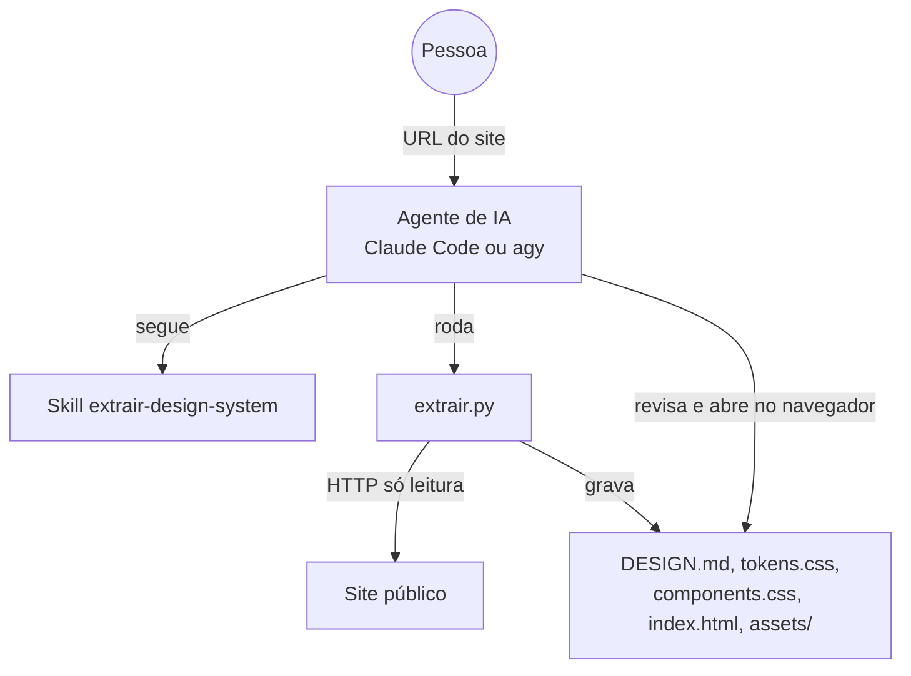
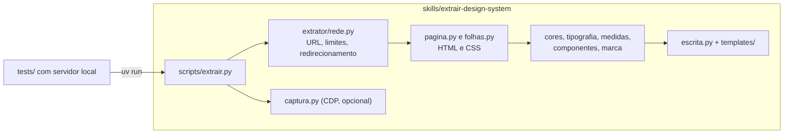
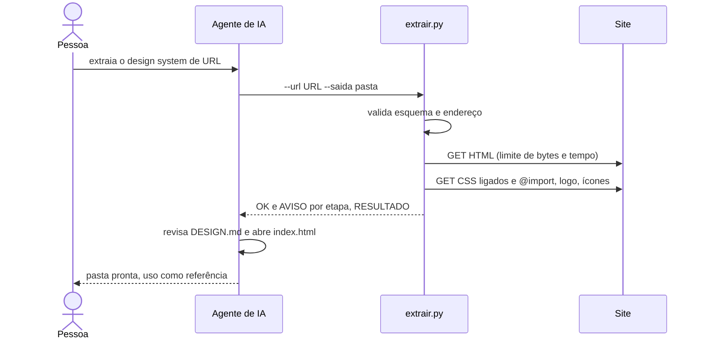

# Criteria 43c3: extrator de design system por URL

## Modelo do módulo (`ARQ-11`)
**Completo.** Primeiro módulo do repositório. Define o contrato público do plugin: a skill, o comando, o CLI `extrair.py` (opções, códigos de saída e `--json`) e a estrutura gerada.

## Restrições (Constitution)
- **`ARQ-04`:** só stdlib (PEP 723, `dependencies = []`). `pytest` e `ruff` ficam no grupo `dev`, fora do plugin.
- **`ARQ-06`:** CLI, códigos e `--json` documentados na skill.
- **`COD-01`:** um módulo por responsabilidade em `scripts/extrator/`.
- **`COD-02` e `TST-05`:** `ruff check` e `pytest` passam na validação local.
- **`COD-03`:** erro de rede, limite e endereço recusado viram mensagem clara e código de saída.
- **`SEG-01`:** URL validada antes de qualquer pedido, em cada redirecionamento e em cada recurso (CSS, `@import`, logo, ícones).
- **`SEG-05`:** o script não imprime cabeçalhos nem conteúdo baixado, só o resumo por etapa.
- **`SEG-07`:** nenhuma dependência de runtime nova. O CDP do Chrome foi conferido na documentação oficial do protocolo.

## Decisões do projeto aplicadas
| Decisão | Onde | Como esta spec respeita |
|---|---|---|
| Determinístico vira script, e a IA usa o script como ferramenta | Princípio do dono | `extrair.py` com saída curta ou `--json`; a IA só revisa |
| Arquivos pequenos | Princípio do dono | Um módulo por responsabilidade; modelos de texto em `templates/` |
| Python com uv, nunca pip | Princípio do dono | Cabeçalho PEP 723; testes com `uv run` |
| Sem CI | Decisão do dono | Validação local com pytest e ruff |
| Repositório público | Pedido do dono | Exemplo fictício; teste e grep de proteção |

## O que já existe (Reuse Check, `DUP-02`)
| Procurei | Onde | Achei | Decisão | Justificativa |
|---|---|---|---|---|
| Formato de plugin (marketplace, `plugins/<nome>/`, `AGENTS.md`, comando) | Plugins públicos do dono | Padrão estável | reusar o formato | Instalação idêntica no Claude Code e no agy |
| Formato de design system por marca | Design systems do dono | `DESIGN.md`, `tokens.css`, `components.css`, `index.html`, `assets/` | reusar a estrutura, sem conteúdo | É o que o pedido chama de "estrutura dessa" |
| Cliente CDP só com stdlib | Verificador de páginas do dono | WebSocket mínimo e `Page.captureScreenshot` | reescrever enxuto | Só a captura; sem as checagens de lá |
| Extratores prontos (bibliotecas de CSS, Playwright) | PyPI e npm | Pacotes de terceiros | não usar | `ARQ-04`; executariam o JS do site |
| README comercial | Plugin `readme-studio` | Banner SVG, selos e tabela de versões | reusar | Pedido do dono |

## Dependências novas (`SEG-07`)
| Item | Tipo | Uso | Justificativa |
|---|---|---|---|
| `pytest`, `ruff` | Desenvolvimento (grupo `dev`) | Testes e lint | Não vão para o plugin |
| Google Chrome ou Chromium | Programa opcional | Só `--captura` | Sem ele, a captura vira aviso |

## Rules e IDs da Constituição Aplicáveis
| Rule | IDs |
|---|---|
| `.agents/rules/sdd-arquitetura.md` | `ARQ-04`, `ARQ-06`, `ARQ-11` |
| `.agents/rules/sdd-codigo-e-testes.md` | `COD-01`, `COD-02`, `COD-03`, `TST-01`, `TST-02`, `TST-05` |
| `.agents/rules/sdd-reuso-e-duplicacao.md` | `DUP-01`, `DUP-02` |
| `.agents/rules/sdd-seguranca.md` | `SEG-01`, `SEG-05`, `SEG-07` |
| `.agents/rules/sdd-fluxo-e-portao.md` | `FLX-01`, `FLX-02` |

## Arquitetura
### Contexto

### Contêineres

### Sequência

## Contrato do CLI
- **Uso:** `uv run scripts/extrair.py --url URL --saida PASTA [--nome MARCA] [--captura] [--sobrescrever] [--limite-bytes N] [--tempo S] [--data AAAA-MM-DD] [--json] [--permitir-local]`.
- **Saída humana:** uma linha por etapa, `NIVEL | etapa | detalhe` (`OK` ou `AVISO`), e a última `RESULTADO: estrutura gerada em PASTA (N avisos)`.
- **`--json`:** `{"ok", "url", "saida", "nome", "avisos", "resumo"}`.
- **Códigos:** 0 estrutura gerada; 1 a página principal não veio (rede, status de erro, não é HTML, passou do limite de bytes ou de tempo); 2 uso inválido (esquema fora de http e https, endereço local ou privado, `DESIGN.md` já existe sem `--sobrescrever`).
- **`--permitir-local`:** libera só o loopback (`127.0.0.0/8` e `::1`), para testes e servidor de desenvolvimento. Rede privada continua recusada.

## Critérios de Aceitação Executáveis
1. `uv run --with pytest pytest -q` passa. Os testes servem o site fictício com `http.server` num thread e conferem:
   - cores (hex, rgb e hsl normalizados; `var()` resolvido; papéis fundo, texto, primária e destaque);
   - fontes (`font-family`, `@font-face`, link do Google Fonts sem baixar), `:root` em `tokens.css`, componentes copiados e logo e favicon em `assets/`;
   - limite de bytes e de tempo (página principal sai 1; recurso grande vira aviso);
   - recusa de endereço privado, local e de redirecionamento para rede privada (código 2);
   - vitrine válida: sem `<script>`, referências locais existentes, abre sem servidor;
   - saída igual em duas rodadas (`--data` fixa) e site mínimo sem logo nem CSS externo.
2. `uv run --with ruff ruff check` passa.
3. Prova manual, sem commitar a saída: `--url https://example.com` e um site real de marca, comparando a paleta e as fontes com o design system conhecido.
4. A vitrine do site fictício abre no Chrome headless em 1440 e 390 sem rolagem horizontal.
5. Grep de proteção sem dado de cliente, imagem pessoal, segredo, e-mail ou caminho pessoal.
